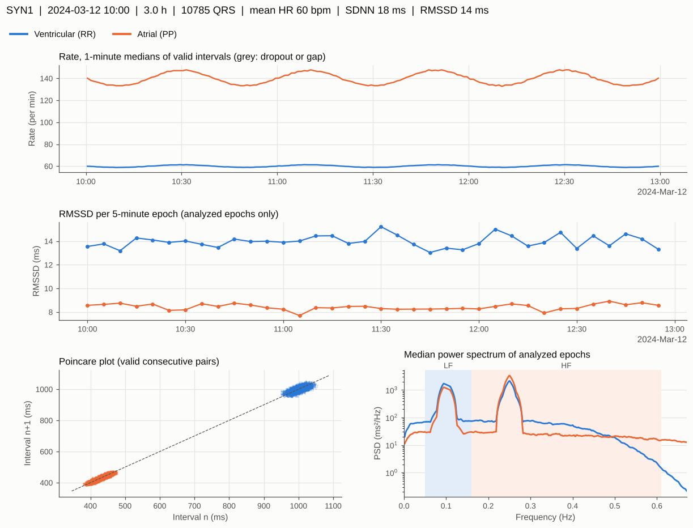
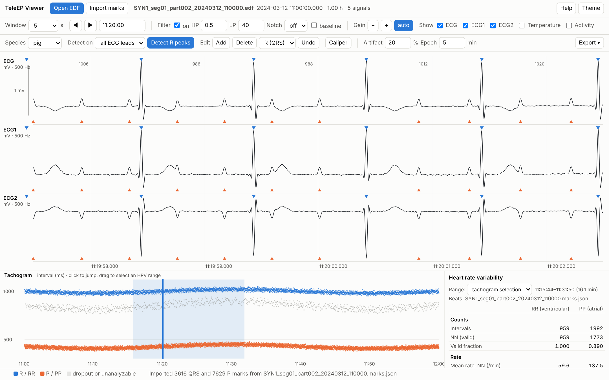

# TeleEP

**Open-source analysis of implantable telemetry ECG: DSI Ponemah to EDF conversion, filtering,
beat detection, RR interval and heart rate variability analysis, and data export.**

TeleEP reads the raw files that DSI Ponemah writes during telemetry acquisition and turns them
into standard EDF+ files and analysis-ready tables. It was built for continuous, multi-day ECG
recordings from pigs with induced conduction disease (complete atrioventricular block, sinus node
dysfunction), where atrial and ventricular activity must be measured independently, and it also
works for dogs, rats, mice and human-like recordings through species presets.

No DSI software, MATLAB or .NET is required. Everything runs locally; no data leave the computer.



## Features

| Step | What TeleEP does |
|---|---|
| **Convert** | Reads `.PnmWav`, `.PnmExp` and `.PnmMarks` directly. Writes EDF+ files that store the original 16-bit samples losslessly with Ponemah's calibration. Recovers acquisition gaps from the block time stamps, writes local wall-clock time (or UTC) with the UTC offset of each file so that recordings spanning a daylight saving time change stay on one time line, calibrates temperature, battery and activity channels, and marks every telemetry dropout as an EDF+ annotation. Can export Ponemah's own beat marks for comparison. |
| **Filter** | Zero-phase Butterworth high-pass, low-pass and band-pass filters, a mains notch (50 or 60 Hz), and running-median baseline removal. Dropouts are bridged during filtering and restored afterwards, so they never produce false deflections. |
| **Detect** | Two detectors. **pigecg** finds QRS complexes and P waves independently in multi-lead recordings, which is required when the atria and ventricles are dissociated; it also delineates T waves. **generic** is a multi-lead Pan-Tompkins R-peak detector with species presets. |
| **Intervals** | RR (ventricular) and PP (atrial) series. Every interval is kept and labelled; intervals across dropouts, at unreliable beats, outside the physiological range, or deviating from their neighbours by more than 20 % are excluded from HRV. Pauses are listed separately and never confused with dropouts. |
| **HRV** | Time domain (SDNN, RMSSD, pNNx, CV, triangular index), frequency domain (Welch or Lomb-Scargle; VLF, LF, HF, LF/HF, normalized units, peak frequencies), nonlinear (Poincaré SD1/SD2, sample entropy, DFA α1/α2), and long-term measures (SDANN, SDNN index). Computed per epoch (default 5 minutes, aligned to the clock), per hour and for the whole recording. |
| **Export** | CSV tables, one Excel workbook with a column guide, JSON summary, an overview figure, filtered signal segments, and marks files for the viewer. |
| **Review** | A single-file HTML viewer for scrolling, filtering, detecting, correcting beats, tachogram, HRV of any range, and export. The EP Annotator records expert corrections, measures the detector's accuracy against them, and can retrain it. |



*Viewer: R marks (blue, top of each lead) and P marks (orange, bottom) for a synthetic recording with
complete atrioventricular block. The tachogram shows RR (blue) and PP (orange) intervals; grey points are
excluded intervals (here, PP intervals that contain a P wave hidden in a QRS complex). HRV is computed for
the range selected on the tachogram.*

## Installation

TeleEP needs Python 3.9 or newer.

```bash
pip install "teleep @ git+https://github.com/<github-account>/teleep"
```

or download the repository and run `pip install .` in its folder. This installs the `teleep`
command and the `teleep-gui` desktop application. Optional extras:

```bash
pip install pywebview       # open the viewer in its own window instead of the browser
```

Standalone desktop applications for Windows and macOS (no Python needed) are built automatically
by GitHub Actions and attached to each release (see `.github/workflows/build-apps.yml`). They are
not code-signed, so the first launch needs one confirmation (macOS: right-click, Open; Windows:
More info, Run anyway).

## Quick start

### Desktop application

```bash
teleep gui
```

The application has three tabs: **Convert** (Ponemah to EDF), **Analyze** (beats, intervals, HRV,
export), and **View and annotate**.

### Command line

```bash
# 1. Convert a Ponemah experiment folder to hourly EDF+ files (local time)
teleep convert "D:/Telemetry/08062023 P10" -o P10_edf --chunk-minutes 60 --ponemah-marks

# 2. Analyze every EDF in the folder as one recording; write tables, Excel and a figure
teleep analyze P10_edf -o P10_results --species pig --workers 4

#    optional: compare the QRS detections with Ponemah's own beat marks
teleep analyze P10_edf -o P10_results --compare-ponemah "D:/Telemetry/08062023 P10"

# 3. Review in the viewer (open an EDF, then Import marks from P10_results/viewer_marks)
teleep view

# Describe a file or experiment, or export a filtered signal segment
teleep info P10_edf/P10_seg01_part001_20230806_155959.edf
teleep export-signal P10_edf/P10_seg01_part001_20230806_155959.edf -o strip.csv \
       --start 600 --duration 10 --hp 0.5 --lp 40 --notch 60

# Try everything on synthetic data
teleep demo teleep_demo
```

`teleep <command> -h` lists every option. Frequently used analysis options:

| Option | Meaning |
|---|---|
| `--species pig\|dog\|human\|rat\|mouse` | detector time constants, physiological RR range, HRV bands |
| `--detector pigecg\|generic` | override the species default (pig: pigecg; others: generic) |
| `--leads ECG ECG1` | use only these ECG signals |
| `--hp 0.5 --lp 40 --notch 60` | filter the signal before detection |
| `--artifact 0.2` or `--artifact off` | artifact threshold (fraction of the local median interval) |
| `--epoch-min 5` | HRV epoch length |
| `--band LF 0.04 0.15 --band HF 0.15 0.4` | custom HRV bands |
| `--spectral lomb` | Lomb-Scargle instead of Welch |
| `--no-p` | skip P-wave detection |

### Python

```python
from teleep.analysis import AnalysisSettings, analyze
from teleep.export import export_all

res = analyze(["P10_edf"], AnalysisSettings(species="pig", epoch_s=300))
print(res.summary["RR"]["rmssd_ms"], res.summary["PP"]["mean_hr_bpm"])
export_all(res, "P10_results")
```

## Typical workflow for a large-animal conduction study

1. Convert each experiment with `teleep convert` (one EDF+ per hour keeps files manageable). When an
   experiment contains several animals, each animal's files go to its own subfolder.
2. Run `teleep analyze` on the folder of one animal. Look at `overview.png`, `hrv_hourly.csv` and `files.csv`
   (dropout and unanalyzable time per hour).
3. Review flagged stretches in the viewer: low-confidence beats are drawn as open triangles, excluded
   intervals are grey in the tachogram, and pauses are listed in `pauses.csv`. Correct marks where
   needed, then export the corrected beats and HRV from the viewer.
4. For a formal accuracy statement, review a sample of stretches in the EP Annotator
   (`teleep annotate P10_edf`) and run `teleep train P10_edf`, which reports sensitivity and positive
   predictivity of the detector against your corrections.

In complete atrioventricular block, RR variability describes the escape rhythm, while PP variability
reflects sinus node function and its autonomic input. TeleEP reports both side by side.

## Outputs

| File | Content |
|---|---|
| `beats.csv` | every QRS: time, wall clock, file, RR, exclusion flag, instantaneous rate, confidence, morphology, PR |
| `pwaves.csv` | every P wave: time, PP, flag, atrial rate, match quality (pigecg) |
| `hrv_epochs.csv` | HRV per epoch for RR and PP |
| `hrv_hourly.csv` | hourly means of the epoch values |
| `hrv_summary.csv`, `summary.json` | whole-recording results, settings, atrioventricular statistics |
| `pauses.csv` | intervals above the pause threshold (default 2 s for pigs) |
| `signal_quality.csv` | dropouts, unanalyzable stretches and gaps between files |
| `files.csv` | per-file counts, dropout and unanalyzable time, run time |
| `results.xlsx` | all of the above in one workbook, with a column guide |
| `overview.png` | rate trend, RMSSD per epoch, Poincaré plot, median spectrum |
| `viewer_marks/*.marks.json` | marks for the viewer, one per EDF file |

Every column is defined in [docs/outputs.md](docs/outputs.md).

## Species presets

| Species | Detector | Refractory | RR range used for HRV | VLF / LF / HF bands (Hz) | Source of bands |
|---|---|---|---|---|---|
| pig | pigecg | 220 ms | 240 to 3000 ms | 0.0033-0.05 / 0.05-0.16 / 0.16-0.61 | scaling law of Behar et al. 2018 at 90 bpm |
| human | generic | 250 ms | 300 to 2000 ms | 0.0033-0.04 / 0.04-0.15 / 0.15-0.4 | Task Force 1996 |
| dog | generic | 200 ms | 200 to 3000 ms | 0.0033-0.067 / 0.067-0.235 / 0.235-0.877 | Behar et al. 2018 |
| rat | generic | 100 ms | 100 to 500 ms | 0.0033-0.19 / 0.19-0.74 / 0.78-2.5 | Aubert et al. 1999 |
| mouse | generic | 60 ms | 60 to 400 ms | 0.0056-0.152 / 0.152-1.24 / 1.24-3.471 | Behar et al. 2018 |

No published reference bands exist for swine, so the pig bands are estimated from heart rate with the
scaling law of Behar et al. (2018). Adjust them with `--band` if your animals' rates differ markedly,
for example `teleep.species.bands_from_heart_rate(120)` for a resting rate of 120 bpm.

## Validation

On an 18.6-hour, three-lead recording of a pig with complete atrioventricular block (atrial rate
130-160 per minute, escape rate 60-71 per minute), TeleEP's QRS detections were compared with
Ponemah's beat marks on the lead where Ponemah performed best: 67,806 beats matched, 176 Ponemah marks
were not found by TeleEP (0.26 %), and TeleEP found 1,409 beats without a Ponemah mark (2.0 %). Review
of the disagreements showed that the TeleEP-only beats are mainly small junctional escape beats that
Ponemah skipped, and that most Ponemah-only marks are Ponemah detections on P waves. The conversion
reproduces Ponemah's exported ECG values to rounding precision. The viewer's HRV calculations agree with
the Python package to within 0.01 % (automated test). Details: [docs/validation.md](docs/validation.md).

## Documentation

* [docs/algorithms.md](docs/algorithms.md): filters, detectors, interval labelling and HRV formulas, with references
* [docs/outputs.md](docs/outputs.md): every output column
* [docs/ponemah-format.md](docs/ponemah-format.md): the Ponemah 6.x file structure as used by the reader
* [docs/validation.md](docs/validation.md): validation data and how to validate on your own data

## Limitations

* The Ponemah reader was developed with Ponemah 6.x files. A different Ponemah version could store
  channel metadata differently; please open an issue with a description if a file does not convert.
* ECG calibration (10 mV per 32,256 counts) was validated against Ponemah's exported values. Temperature,
  battery and activity use the range stored in the file header and were checked for plausibility only.
* pigecg detects P waves only when part of the recording has P waves separated from the QRS complex by
  more than 150 ms (atrioventricular block or a long PR interval). With 1:1 conduction and a normal PR
  interval, analyze RR intervals only (`--no-p`).
* P waves that coincide with a QRS complex cannot be seen in any lead; the resulting long PP intervals
  are excluded from HRV automatically.
* HRV assumes that the analyzed rhythm is autonomically modulated. In escape rhythms, Wenckebach
  periodicity or frequent ectopy, interpret RR variability with care; the artifact flags show where the
  rhythm is irregular for non-autonomic reasons.

## Citing

If you use TeleEP in published work, please cite the software (see [CITATION.cff](CITATION.cff)) and
the methods references listed in [docs/algorithms.md](docs/algorithms.md).

## Authors

* **Joshua Kyungjoon Cho** initiated the project, shaped its direction and features, and tested the tools
  on laboratory recordings.
* **Hee Cheol Cho**, Johns Hopkins University School of Medicine, provided the scientific direction and
  the telemetry studies for which the software was built.

## Acknowledgments

The recordings used for development came from porcine telemetry studies in the Cho laboratory at Johns
Hopkins University. Parts of the code and documentation were developed with the assistance of Claude,
an AI model by Anthropic. "DSI" and "Ponemah" are trademarks of Data Sciences International; TeleEP is
an independent project and is not affiliated with or endorsed by DSI.

## License

BSD 3-Clause. See [LICENSE](LICENSE).
